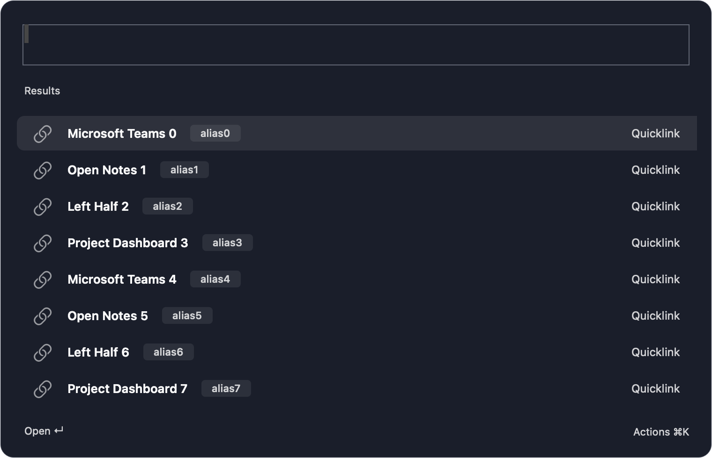

# Ruycast

Ruycast is an open-source keyboard launcher for macOS, written in Rust. Launch apps, search windows and Safari tabs, and run your own commands. Configure it in Settings or through the CLI and a JSON file.



## Install from source

The current source-build guide is for **Apple silicon Macs running macOS 14 or later**. It covers dependencies, local signing, installation and the first launch. The current 0.9.0 code is available on `main`. The [Releases page](https://github.com/viggomeesters/ruycast/releases) offers tagged source archives and checksums. Public notarized app distribution is deferred.

[Install Ruycast](docs/INSTALLATION.md) · [Take the first steps](docs/GETTING-STARTED.md)

## What you can do

- **Launch apps and commands.** Press **Control–Option–Space**, type an app name or alias, and press Return. Open websites and folders or run your own scripts.
- **Find what is already open.** Search Safari tabs and open windows, or look up actions in the active app's menus.
- **Reuse text and links.** Create snippets and quicklinks with inputs. Press **Control–Option–V** for clipboard history, including previews, retention controls and exclusions.
- **Set up keyboard shortcuts.** Assign a shortcut to a command, use Caps Lock as Hyper, or tile and move windows between displays.
- **Quit idle apps automatically.** Set a timeout per app in Settings → Applications and explicitly opt in to quitting when Ruycast cannot determine activity.
- **Inspect activity locally.** Use Dashboard for command usage and errors, or open System Monitor for CPU, memory and other resource usage.

## Make it yours

Open Settings from the menu bar or search for **Ruycast Settings**. Commands, aliases and shortcuts live in `~/.config/ruycast/config.json` by default. You can select another configuration folder in Settings → Advanced. Edits reload automatically, and an invalid edit keeps the last working configuration.

Use the same configuration from the CLI. For example, inspect the running app and preview a command:

```sh
ruycast status
ruycast search safari
ruycast run app.safari --dry-run
```

[Configuration and CLI reference](docs/CONFIG.md) · [Troubleshooting](docs/DIAGNOSTICS.md)

## Privacy and security

Clipboard history and analytics stay on your Mac. Dashboard analytics record counts, timings and fixed error categories. You can pause collection or reset it. Website icons are fetched from the relevant sites and cached locally. Review any script or configuration you import before running it.

[Security and data storage](SECURITY.md) · [Analytics](docs/ANALYTICS.md)

## Contribute

Ruycast keeps all repository-owned executable code in Rust, including tests, helpers and build tools. Read the [Rust-only source policy](CONTRIBUTING.md#rust-only-source-policy) before contributing.

The [native development guide](rust-native/README.md#current-build-and-validation-routes) lists the locked Cargo commands for building the host and CLI, running the macOS validation matrix, and checking disk space or cleaning build caches. See [Source export](docs/SOURCE-EXPORT.md) for the standalone Rust exporter and verification command. A local build or export does not install or publish Ruycast.

[Report a bug or suggest a feature](https://github.com/viggomeesters/ruycast/issues/new/choose) · [Development and testing](CONTRIBUTING.md) · [Architecture](docs/ARCHITECTURE.md) · [Changelog](CHANGELOG.md)

Ruycast is available under the [MIT license](LICENSE).
