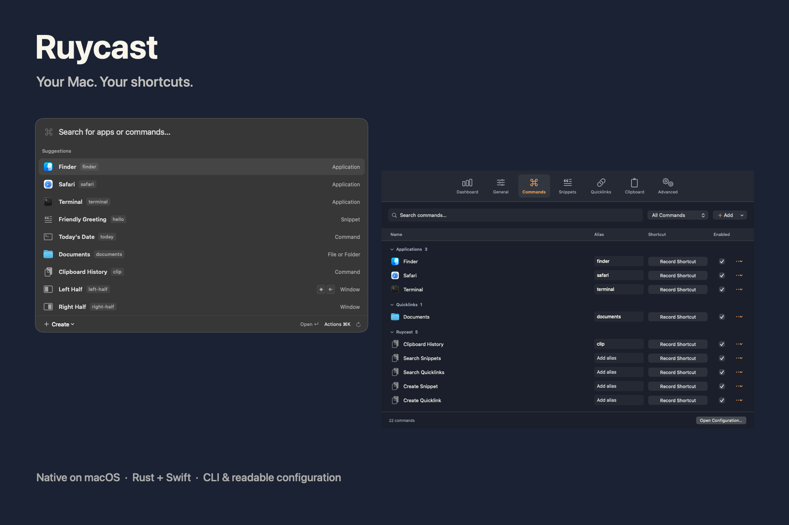

# Ruycast

A native keyboard launcher for your Mac. Open apps, run your commands and make it yours through a CLI and readable files.



**Rust native beta · macOS 14+**

## Your everyday shortcuts

- **Launch anything.** Apps, websites, folders and scripts, with your own aliases and hotkeys.
- **Type less.** Snippets with automatic keyword expansion, parameterized quicklinks and Caps Lock as Hyper.
- **Keep useful copies.** Search text, images and file references in clipboard history, with previews and retention controls.
- **Find app actions.** Search the active app’s menus, see their shortcuts and run available actions.
- **Find Safari tabs.** See open tabs first when you open the launcher, or search by title or address alongside apps and commands.
- **Find open windows.** Search by document or app name and switch to the selected existing window.
- **Arrange your windows.** Halves, thirds, maximize, restore and move between displays.
- **Stay in control.** Native Settings, a system monitor, and a local Dashboard for usage, errors and timings.
- **Work with your AI tools.** Coding agents can inspect status, edit configuration and run actions in the background. Configuration lives in files you can read and version.

## Install

The app host, CLI, build receipts and packaging are implemented in Rust. Current source betas are available on the [Releases page](https://github.com/viggomeesters/ruycast/releases). A notarized app download remains deferred.

The repository is not yet entirely Rust: it still contains historical Swift sources, Python tools and tests, and C/Objective-C test fixtures. [The repository migration](https://github.com/viggomeesters/ruycast/issues/157) replaces or retires that code in small steps while preserving its required behavior.

Build with macOS command-line developer tools and Rust/Cargo 1.92 or later. Python 3.10+ is needed only for compatibility entrypoints and unchanged test validators; Swift is needed for explicit historical parity oracles, not the production build. Dependencies must already be cached for the offline build:

Run these existing compatibility entrypoints from the reviewed checkout or source snapshot. They still use shell and Python to reach the Rust build tools:

```sh
bash scripts/build-native.sh -c release
python3 scripts/build_receipt.py verify
```

These commands build and verify the Rust pair under `.build/full-rust-release`. They do not install, sign or publish it. Follow the [installation procedure](docs/INSTALLATION.md) when the candidate is accepted for your intended use.

Allow Ruycast in **System Settings → Privacy & Security → Accessibility** for window management, Hyper, snippet expansion and pasting into other apps. Enable Hyper and snippet expansion in Settings when you want them.

[Build requirements and signing](docs/INSTALLATION.md) · [Getting started](docs/GETTING-STARTED.md)

## Usage

Choose your theme and menu bar visibility in Settings → General. Enable **Separate Left and Right Command** there to assign different app shortcuts to `L⌘` and `R⌘`.

Press **Control–Option–Space**, type an app name or alias, then Return. Open clipboard history with **Control–Option–V**. Command–K opens actions; arrow keys navigate them.

For a quicklink with one input, type its alias followed by a space and your query, then Return.

Create quicklinks in Settings or through the CLI:

```sh
ruycast config add '{"id":"link.project-docs","title":"Project Docs","kind":"url","target":"https://example.com/docs","aliases":["projectdocs"]}'
ruycast search projectdocs
ruycast run projectdocs --dry-run
ruycast run projectdocs
```

Your configuration defaults to `~/.config/ruycast/config.json`. Choose another folder in Settings → Advanced or with `ruycast config directory /absolute/folder`. Your choice persists across app updates; clipboard history and runtime files stay local. File edits reload automatically; an invalid edit keeps the last working configuration.

[Configuration and CLI reference](docs/CONFIG.md) · [Architecture](docs/ARCHITECTURE.md)

## Privacy and security

Clipboard history and analytics stay on your Mac. Analytics records counts, durations and fixed error categories; it excludes typed queries, clipboard contents and script input. Pause or reset it in Dashboard, and export an aggregate summary when needed.

Website icons contact the relevant websites and use a local cache. Only add scripts and command definitions you trust.

[Security and data storage](SECURITY.md) · [Analytics](docs/ANALYTICS.md) · [Command errors](docs/DIAGNOSTICS.md)

## Development

```sh
make check
bash scripts/check-settings.sh
python3 scripts/build_receipt.py verify-check
```

These are compatibility entrypoints, not a completed Rust-only test suite. The native matrix still uses Python validators, and the full `check` entrypoint refuses its unmapped Python-discovery gate. The `settings` pipeline also requires its bound native validation artifacts.

The previous full Swift-comparison and F1 measurement campaign was discontinued on 10 November 2026. Current work uses focused checks for each change and separate short launcher-time and memory measurements. Historical comparison code remains pending retirement; its presence does not make the discontinued campaign a release requirement.

[Contributing](CONTRIBUTING.md) · [Performance](docs/PERFORMANCE.md) · [Product contract](docs/vision.json)

## Releases

The [current releases](https://github.com/viggomeesters/ruycast/releases) include the 0.9.0 Rust source betas. They are distinct from the older 0.8.x releases and do not include a notarized app download. Final rewrite acceptance remains tracked in [issue #86](https://github.com/viggomeesters/ruycast/issues/86); the remaining repository-wide language migration is tracked separately in [issue #157](https://github.com/viggomeesters/ruycast/issues/157).

[Changelog](CHANGELOG.md)

## License

[MIT](LICENSE). Ruycast is an independent project. It is not affiliated with Raycast.
