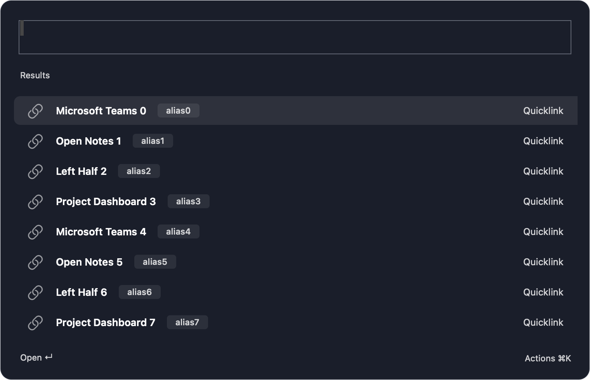

# Ruycast in use

The Rust launcher opens with a compact search field and expands below it when results appear. Use Settings to manage commands, snippets, shortcuts and clipboard preferences.

The [historical hero](../assets/hero.png) shows the retired Swift interface. The original renderer is available at [the retired Swift package revision](https://github.com/viggomeesters/ruycast/tree/f1259ea51dd312c3049d6af77b9275a7fdad54e3).

For current Rust UI review, use the owned hidden AppKit scenarios in `rust-native/examples/ui_completion.rs` and the [native validation routes](../rust-native/README.md#current-build-and-validation-routes).
